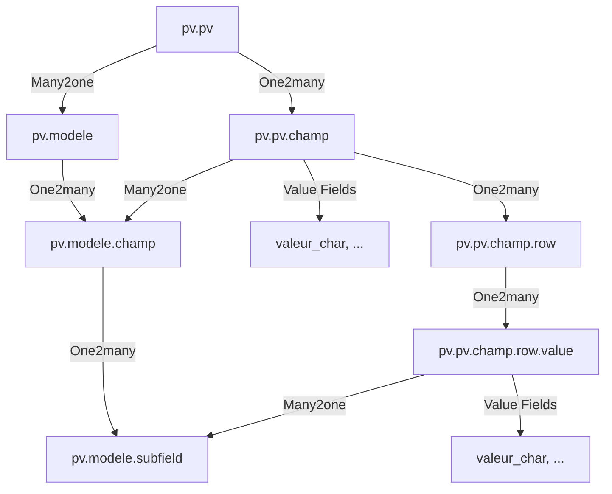

# README AUDIT - STEP 2: Full Relational Data Model

This document audits the complete structural data model for the `pv_dynamic` module, ensuring strict adherence to the non-negotiable architectural rules.

## 1️⃣ Model-by-Model Breakdown

### `pv.modele` (PV Template)
*   **Purpose**: Root object for defining a PV structure.
*   **Fields**:
    *   `name` (Char, Required): The name of the template.
    *   `champ_ids` (One2many → `pv.modele.champ`): The collection of fields defined for this template.
    *   `active` (Boolean, Default: True): Standard Odoo archiving field.
*   **Enforcement**: `champ_ids` uses standard Odoo behavior; however, the architectural rule requires that modifying this structure deletes related PVs (to be implemented in Logic stage).

### `pv.modele.champ` (Template Field Definition)
*   **Purpose**: Defines a single field within a template.
*   **Fields**:
    *   `modele_id` (Many2one → `pv.modele`, Required, **ondelete='cascade'**): Link to parent template.
    *   `name` (Char, Required): The label of the field.
    *   `type_champ` (Selection, Required): `char`, `date`, `integer`, `float`, `percentage`, `boolean`, `complex`.
    *   `required` (Boolean): Structural required flag.
    *   `sequence` (Integer): For UI ordering.
    *   `subfield_ids` (One2many → `pv.modele.subfield`): Defined only if `type_champ` is `complex`.

### `pv.modele.subfield` (Complex Field Structure)
*   **Purpose**: Defines the columns/subfields for a 'complex' (grid-like) field.
*   **Fields**:
    *   `champ_id` (Many2one → `pv.modele.champ`, Required, **ondelete='cascade'**): Link to parent complex field.
    *   `name` (Char, Required): Label for the sub-column.
    *   `type_champ` (Selection, Required): Same as above but **excluding 'complex'** (no recursion).
    *   `required` (Boolean): Flag for the subfield.
    *   `sequence` (Integer): Order within the grid.

### `pv.pv` (PV Instance)
*   **Purpose**: The actual data container generated from a template.
*   **Fields**:
    *   `name` (Char): User-assigned name for the instance.
    *   `modele_id` (Many2one → `pv.modele`, Required, **ondelete='cascade'**): The blueprint this PV was born from.
    *   `champ_ids` (One2many → `pv.pv.champ`): The static copies of the blueprint fields.
    *   `date` (Date, Default: Today): Creation/Reference date.

### `pv.pv.champ` (PV Instance Field)
*   **Purpose**: A structural copy of a template field, holding either an atomic value or links to rows.
*   **Fields**:
    *   `pv_id` (Many2one → `pv.pv`, Required, **ondelete='cascade'**): Link to parent PV.
    *   `modele_champ_id` (Many2one → `pv.modele.champ`, Required): Link to the original definition.
    *   `name` (Char, Required): Snapshot of the label.
    *   `type_champ` (Selection, Required): Snapshot of the type.
    *   `required` (Boolean): Snapshot of the requirement flag.
    *   `sequence` (Integer): Order.
    *   **Value Storage**: `valeur_char`, `valeur_date`, `valeur_integer`, `valeur_float`, `valeur_percentage`, `valeur_boolean`.
    *   `row_ids` (One2many → `pv.pv.champ.row`): Links to rows if `type_champ == complex`.

### `pv.pv.champ.row` (Complex Field Row)
*   **Purpose**: A single horizontal entry in a complex grid field.
*   **Fields**:
    *   `champ_id` (Many2one → `pv.pv.champ`, Required, **ondelete='cascade'**): Link to parent field instance.
    *   `value_ids` (One2many → `pv.pv.champ.row.value`): Individual cell values for this row.
    *   `sequence` (Integer): Row order.

### `pv.pv.champ.row.value` (Atomic Cell Value)
*   **Purpose**: The final storage point for a specific cell in a complex grid.
*   **Fields**:
    *   `row_id` (Many2one → `pv.pv.champ.row`, Required, **ondelete='cascade'**): Link to parent row.
    *   `subfield_id` (Many2one → `pv.modele.subfield`, Required): Link to the sub-blueprint.
    *   `type_champ` (Selection, Required): Snapshot of subfield type.
    *   **Value Storage**: Same fields as `pv.pv.champ` (`valeur_char`, etc.).

## 2️⃣ Full Relationship Flow Explanation

Data flows from the **Template side** (Left) to the **Instance side** (Right) at creation. At runtime, the structure of the PV is entirely self-contained within the `pv.pv.*` models, with Many2one links back to the Blueprint for reference/cloning context.

## 3️⃣ Cascade Deletion Mapping

Relational integrity is strictly enforced via `ondelete='cascade'` at the DB level:

1.  **Template Deletion (`pv.modele`)**:
    *   → Cascades to `pv.modele.champ`.
    *   → Cascades to `pv.modele.subfield`.
    *   → **Architectural Rule**: Must also cascade to `pv.pv` (Enforced via `ondelete='cascade'` on `pv.pv.modele_id`).
    *   → `pv.pv` Deletion then triggers its own chain (see below).

2.  **PV Deletion (`pv.pv`)**:
    *   → Cascades to `pv.pv.champ`.
    *   → If complex: Cascades to `pv.pv.champ.row`.
    *   → Cascades to `pv.pv.champ.row.value`.

3.  **Field/Row/Value Removal**:
    *   Deleting a `pv.pv.champ` wipes all its `row_ids`.
    *   Deleting a `pv.pv.champ.row` wipes all its `value_ids`.

## 4️⃣ Structural Integrity Risks

*   **Dangling Many2one**: While `pv.pv` is linked to `pv.modele`, if a specific `pv.modele.champ` is deleted *without* deleting its parent `pv.modele`, the `pv.pv.champ` will have a dangling `modele_champ_id`. The architectural rule "Template modification -> Delete PVs" is critical to solve this (Logic Step).
*   **Selection Mismatch**: If the `Selection` list in `pv.modele.champ` is updated in code but clones already exist in `pv.pv.champ`, Odoo might show value errors if the underlying string key changed.
*   **Deep Recursion Performance**: A template with 50 fields, where 10 are complex, and each complex field has 5 subfields and 100 rows, results in 5,000+ records for a single PV. CRUD operations will require careful ORM batching.

## 5️⃣ Confirm What Is NOT Yet Implemented

As per the requirements for Step 2:
*   **No Cloning**: The logic to generate `pv.pv.champ` from `pv.modele.champ` at the moment of PV creation is not yet present.
*   **No Validation**: Standard Odoo validation is in effect, but no custom rules (e.g., hidden fields bypassing validation) have been added.
*   **No Conditional Logic**: The model includes flags for visibility, but no code to evaluate them.
*   **No Structural Change Detection**: There are no `unlink` or `write` overrides yet to detect if a template was modified and trigger the deletion of related PVs.
